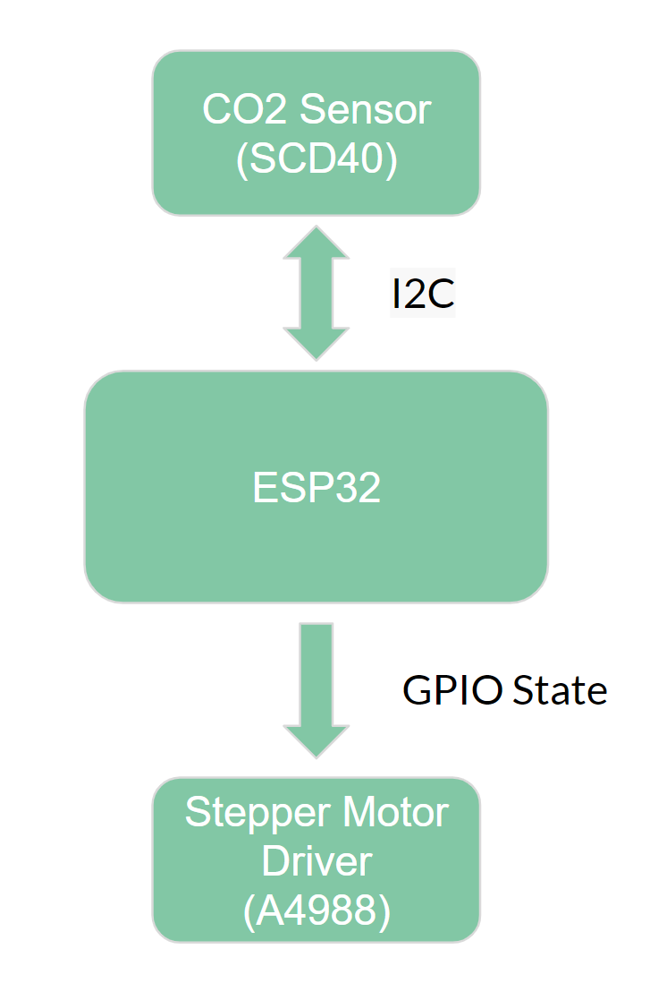
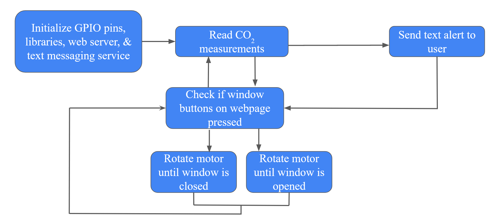
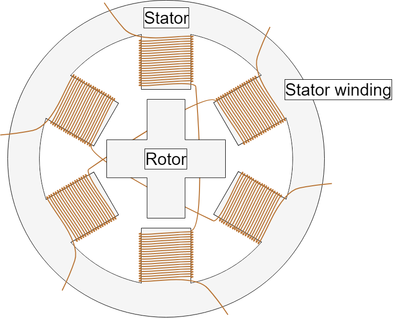
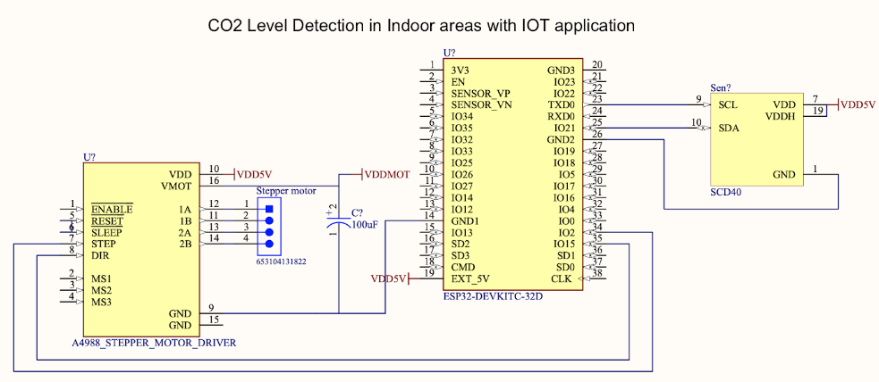
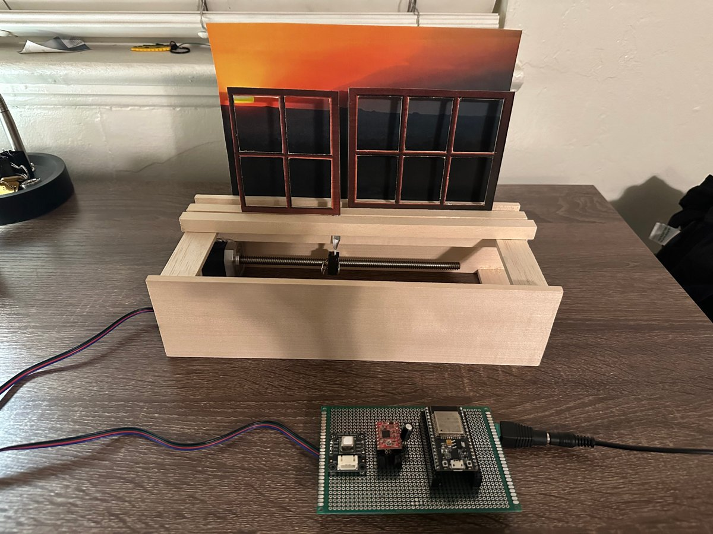
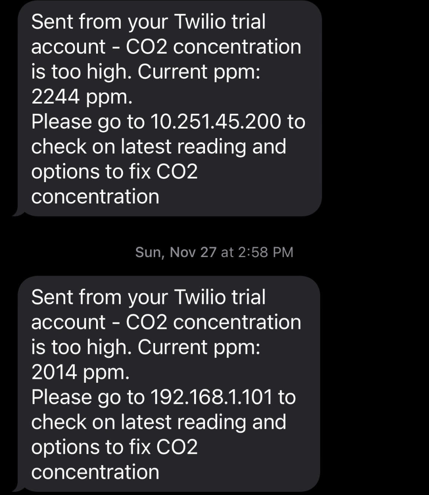
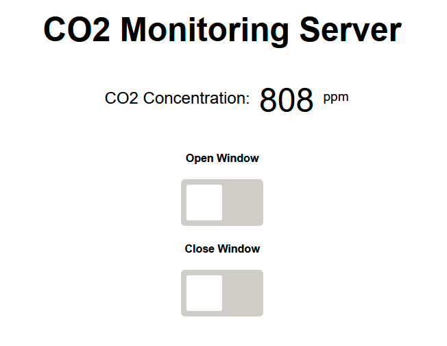

# Project Report: CO₂ Level Detection in Indoor Areas with IoT Application

**Authors:** Christopher Lim, David Scott Gomez, Harkiret Singh, Sahil Shah
**Advisor:** Dr. Sotoudeh Hamedi-Hagh
**Course:** EE 198B Senior Design, San José State University
**Date:** December 6, 2022

> This is an adapted version of our final report. The firmware from the report's appendix lives in [`firmware/co2_monitor/co2_monitor.ino`](../firmware/co2_monitor/co2_monitor.ino).

---

## Executive summary

Our main goal was to build a device that measures indoor CO₂ concentration and alerts users so they can increase ventilation, for example by opening a window, and keep the space safe to breathe. The problem came from the rise in COVID-19 cases: studies found a direct relationship between CO₂ concentration and the risk of spreading the virus indoors.

We used an ESP32 microcontroller connected to a stepper motor and a CO₂ sensor. The ESP32 detects the concentration and alerts the user through **Twilio**, a programmable communication service for calls and texts. The alert includes an IP address served by an HTTP server on the WiFi-enabled ESP32. At that address users can check the CO₂ level and open the window with a button on the webpage.

## 1. Introduction

The COVID-19 pandemic began in March 2020 and was still ongoing at the time of this project; by 2022 the U.S. death toll had passed 1 million [1]. We wanted to build something that would help detect and reduce transmission risk, so people could feel a bit more at ease.

Transmission risk is much higher indoors than outdoors [2]. During our research we found a study proposing an inexpensive and effective way to track indoor COVID-19 risk: **measuring CO₂ concentration** [3]. Our project applies this idea. A CO₂ sensor connected to a WiFi-enabled microcontroller alerts the user when a set threshold is reached. The alert links to a webpage that shows the current CO₂ concentration, where the user can open or close a window to increase airflow. When a button is pressed, the microcontroller signals a stepper motor driver to rotate the motor in the chosen direction.

Poor ventilation raises a room's CO₂ concentration. High CO₂ is a health hazard: at around 2,000 ppm and above, human cognitive function declines. People in poorer neighborhoods tend to live with more air pollution and worse ventilation [4]. So we aimed to keep the cost of materials as low as possible, so the device could be sold cheaply and help lower-income households live healthier lives.

## 2. Methodology

### 2.1 Design objective

- Reduce COVID-19 risk by tracking CO₂ and giving users ways to increase ventilation.
- Use **Internet of Things** functionality, so the device connects to a network and users can interact with it over WiFi.
- Keep the device footprint small and the cost low.

### 2.2 Theory: Internet of Things

IoT is a system of interconnected devices that transfer data over a network without human-to-human or human-to-computer interaction [5]. Smart devices with processors, sensors and communication chips collect, send and act on data from their environment. IoT communication can be unidirectional or bidirectional. Our design is **bidirectional**: it sends and receives data between the CO₂ sensor side and the stepper motor side. Data from the microcontroller travels over WiFi, which keeps the device low-power.

### 2.3 Overall system

The microcontroller talks to the CO₂ sensor over **I²C** and to the stepper motor driver by setting **GPIO pins high and low**. Choosing an I²C sensor mattered: it makes it easy to add more air-quality sensors later. The stepper driver has no communication protocol like I²C, so the program powers and rotates the motor by toggling GPIO pins periodically.

### 2.4 Software implementation

The program first initializes the GPIO pins, libraries and APIs. The ESP32 then starts reading the room's CO₂ concentration (in ppm) from the sensor. If a reading is above the threshold, the ESP32 sends a text alert containing a link to its webpage (its IP address). On that page the user sees the current concentration and options to improve ventilation, which in our project means opening a window. When the user presses Open or Close, the ESP32 drives the stepper driver pins to turn the motor in the right direction. The program then keeps looping between reading CO₂ and checking for button presses.

The code is written in C/C++ (Arduino) with HTML and JavaScript for the webpage. The HTML/JS is adapted from Rui Santos' tutorials at randomnerdtutorials.com.

A key library is the **ESP32 Asynchronous Web Server**. An async server can handle requests from several users on the same network without serving them one at a time. That matters here, because a household will usually have several people using the device.

### 2.5 Motor considerations and implementation

We designed for a single horizontal **sliding window**. The motor needed enough torque to slide the pane and had to move it between two positions accurately. Speed mattered less, and a window that opens too fast could even be a safety hazard.

- **Brushed DC motors** (as in cheap RC cars) are the cheapest, but have low precision and low torque.
- **Brushless motors** (fans, drones) are fast, but have even less precision and torque.
- **Stepper motors** (3D printers, standing desks) offer both **precision** and **torque**, so they fit our criteria. A stepper would also be the right choice for swinging windows.

A stepper motor uses many small coils and magnets. Energizing each coil set in sequence makes current "chase" the fixed magnets in the casing, which turns the motor in precise steps. Energizing each coil set by hand isn't practical, so a **driver module** does it, energizing the coils in fast sequence for any number of steps and reversing the order to change direction. We chose the **A4988** because it is very cheap and more than enough for our motor. A real installation might need a higher-power driver, since real windows can be heavy or jammed by debris in the rail.

### 2.6 Circuit and power

Every component runs from a single **5 V DC supply**. The ESP32, SCD41/SCD40 and A4988 draw at most about **1.5 A** combined, so we used a **5 V / 3 A** PSU. The ESP32's built-in LDO converts 5–12 V to 3.3 V, so it connects directly to the 5 V pin. The SCD4x (3–5.5 V) and A4988 can also connect directly, which keeps the circuit simple.

The A4988 board uses low-ESR ceramic capacitors, which makes it vulnerable to LC voltage spikes. These spikes can exceed the board's **35 V** maximum and permanently damage it, so we placed a **100 µF electrolytic capacitor** between VMOT and GND.

We also considered a **wireless handheld version**: a 3.7 V Li-Po battery with a boost converter regulating to 5 V. This would have made the circuit more complex and might have needed reverse-polarity protection.

## 3. Results and discussion

We met most of our goals: an SMS alert system that reads indoor CO₂ and gives the user the option to open a window for more ventilation.

 <em>The device connected to our proof-of-concept window model</em>

The IoT features worked. The ESP32 connected to Twilio and sent a text when CO₂ went above the threshold. The text linked to a webpage that showed the current concentration and had controls to open and close the window.

| SMS alert | Webpage |
|:---:|:---:|
|  |  |

**Demo video:** https://youtu.be/F_ZmzqogyNA

### Bill of materials

| Device / material | Price (USD) |
|---|---:|
| ESP32 microcontroller | 10 |
| SCD40 CO₂ sensor | 40 |
| NEMA 17 stepper motor | 30 |
| A4988 stepper driver | 5 |
| Protoboard | 7 |
| Header pins | 9 |
| AC/DC adapter | 12 |
| **Total** | **113** |

Adding the woodwork for the proof-of-concept model raises the total from $113 to $138. Even without the woodwork, the project costs over $100, which is far more than we wanted. We intended it to be cheap to mass-produce and didn't meet that goal.

## 4. Conclusions and recommendations

Most of our goals were met. We built a simple, easy-to-use system that measures indoor CO₂, alerts users when it's high, and hosts a webpage with an option to open a window. The soldered electronics are compact, but the stepper motor attached to the window is fairly large. That is expected, since opening a window needs a lot of torque.

The project was more expensive than intended. With more time, we would work on lowering the cost so lower-income households, who are often more exposed to poor air quality and COVID-19, could use it.

**Future work**

- Finer motor control, so users can choose how far the window opens
- Support for more window types
- A local LCD for checking CO₂ at a glance
- A more readable webpage

## 5. References

1. J. Bosman, "The Lost Americans," *The New York Times*, May 14, 2022. https://www.nytimes.com/2022/05/14/us/covid-one-million-deaths.html
2. C. Stulpin, "Transmission of respiratory illnesses outdoors 'definitely happens' but less than indoors," *Healio*, Dec. 8, 2020. https://www.healio.com/news/infectious-disease/20201207/transmission-of-respiratory-illnesses-outdoors-definitely-happens-but-less-than-indoors
3. Z. Peng and J. L. Jimenez, "Exhaled CO₂ as a COVID-19 infection risk proxy for different indoor environments and activities," *Environmental Science & Technology Letters*, vol. 8, no. 5, pp. 392–397, 2021.
4. C. Katz, "People in poor neighborhoods breathe more hazardous particles," *Scientific American*, Nov. 1, 2012. https://www.scientificamerican.com/article/people-poor-neighborhoods-breate-more-hazardous-particles/
5. "What is the Internet of Things? WIRED explains," *Wired UK*. https://www.wired.co.uk/article/internet-of-things-what-is-explained-iot
6. Wisconsin Department of Health Services, "Carbon Dioxide," 2022. https://www.dhs.wisconsin.gov/chemical/carbondioxide.htm
7. Pololu, "A4988 Stepper Motor Driver Carrier." https://www.pololu.com/product/1182
